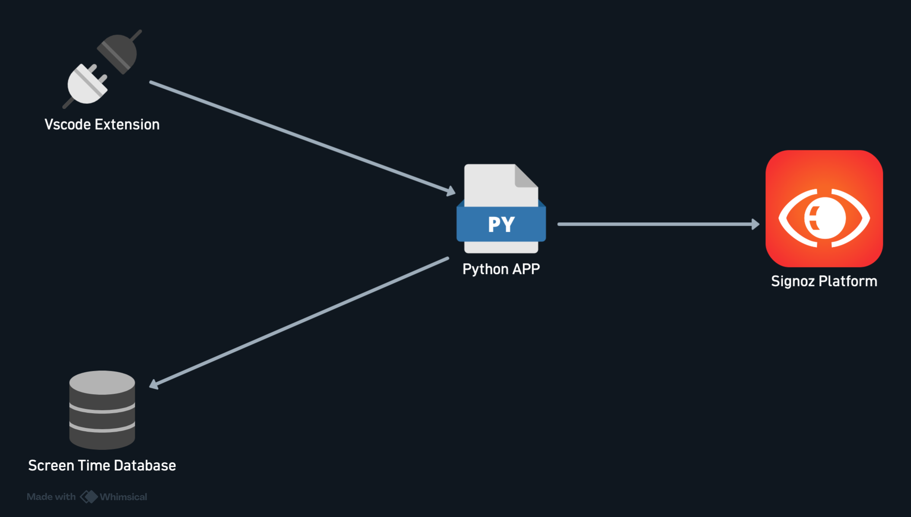
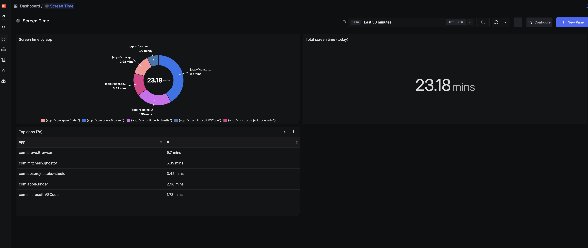
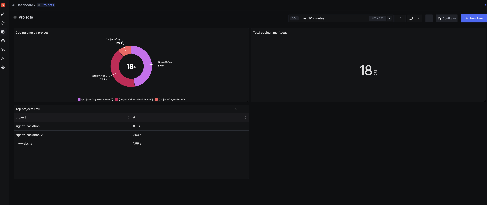

+++
authors = ["Joshua Jebaraj"]
title = "Capturing ScreenTime Signals with Signoz"
date = "2026-07-25"
description = "In this blog I'll share my experience with Signoz Hackathon"
tags = ["Devops"]
+++


## Problem Statement
If you've been like me, spending most of your time around computers, it's sometimes difficult to track where you actually spend it. Some weeks you might feel like you spent more time on one app, but ended up spending less  and on another end, you might think you spent less time somewhere, but actually spent more. So I built a system that tracks exactly where my time went each day  down to the app and the project using my own Screen Time data and SigNoz.


## Solution and Overview
The system I build has two parts one a python application which serves both as a collector and server which collects the screen time info from the Mac OS and vs code extensions which tells on which projects you are working on and send it back to the collector and then the python application sends the data to the sigNoz server.


The system I built has two parts: a Python application that acts as both collector and server, and a VS Code extension. The Python app polls macOS's Screen Time database directly to see which apps I've been using, while the VS Code extension reports which project I'm actively working on and sends that back to the collector over a local endpoint. The Python app then pushes both signals to SigNoz as OpenTelemetry metrics.




The Python application queries the macOS Screen Time database at a regular interval to see which apps I've been using. The VS Code extension sends the active project to the collector over a local endpoint whenever I switch focus. The Python app then pushes both signals to SigNoz as OpenTelemetry metrics.


### Why SigNoz?
Once the application started collecting metrics, I needed a backend to store and query them. I chose **SigNoz** for a couple of reasons:

- **OpenTelemetry-native** – Since the application emits OpenTelemetry (OTel) metrics, I wanted a backend that natively supports OTLP without requiring any translation or compatibility layer.
- **Open source and self-hosted** – The application collects my screen-time and project activity, which can reveal sensitive information about what I'm working on. Self-hosting ensures that data stays on infrastructure I control instead of being sent to a third-party SaaS.

I used **Foundry** to deploy a self-hosted SigNoz stack. Once the application started emitting metrics, I used SigNoz's built-in dashboards to visualize and explore the data.

## Screen Time Metrics 

The first metric we're collecting is **screen time**. macOS stores Screen Time data in a local SQLite database called `knowledgeC.db`, located at:

```text
~/Library/Application Support/Knowledge/knowledgeC.db
```

Our Python application polls this database every 5 minutes by default, looking for any newly completed application usage sessions. Each session is then converted into an OpenTelemetry metric and exported to the SigNoz backend.

> One interesting detail I discovered is that the database doesn't store timestamps using the Unix epoch (seconds since 1970-01-01). Instead, it uses Core Data's epoch, which counts seconds since 2001-01-01. To produce accurate timestamps in SigNoz, I had to add the offset between the two epochs (978,307,200 seconds) before converting the values to Unix timestamps.

## Project Metrics 

The second metric I'm collecting is **project activity**, using a custom VS Code extension.

Whenever I open or return to a project, the extension determines the active workspace and sends a **`focus`** event to the Python application over a local HTTP endpoint. When I switch to a different project or move focus away from VS Code (for example, to a browser or terminal), it sends a corresponding **`blur`** event.

The Python application pairs each `focus` event with the next `blur` event to form a coding session. It then calculates the session duration, timestamps it with the original start and end times, and exports it as an OpenTelemetry metric to SigNoz. This approach means the backend stores individual coding sessions rather than periodically sampled values, making it possible to accurately aggregate coding time over any selected time range.


## Dashboard

Collecting Metrics is only an half part , the other half is to visualize the data and find insights from the data . Here I am using the sigNoz dashboard to visualize the data . There are two dashboards I have created for each metrics

### Screen Time Dashboard

This dashboard shows how much time we spend on each application as the pie chart and also displays the total screen time and apart from that we can also see the top 7 applications we spend the most time on.




This dashboard shows how much time we spend on each project as the pie chart and also displays the time we spend on the projects and apart from that we can also see the top 7 projects we spend the most time on.




## Conclusion 

By the end of the project, I was able to get data about the screen time and projects I've been working on, and visualize it on the SigNoz dashboard. Right now it's in the initial stage. The future scope can be extended to collecting metrics from browsers, so we can get details on which websites we spend more time on, and collecting metrics from AI harnesses, so we understand where we spend more time and tokens on a project. Right now the application only works on Mac; in the future, it might be extended to other operating systems.


