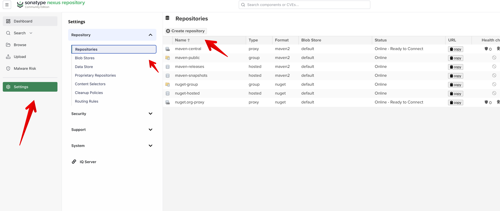
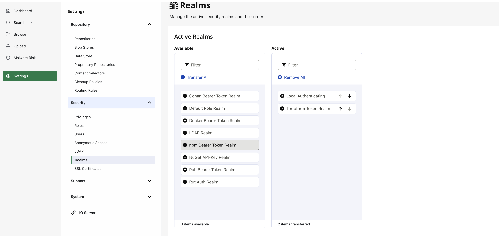
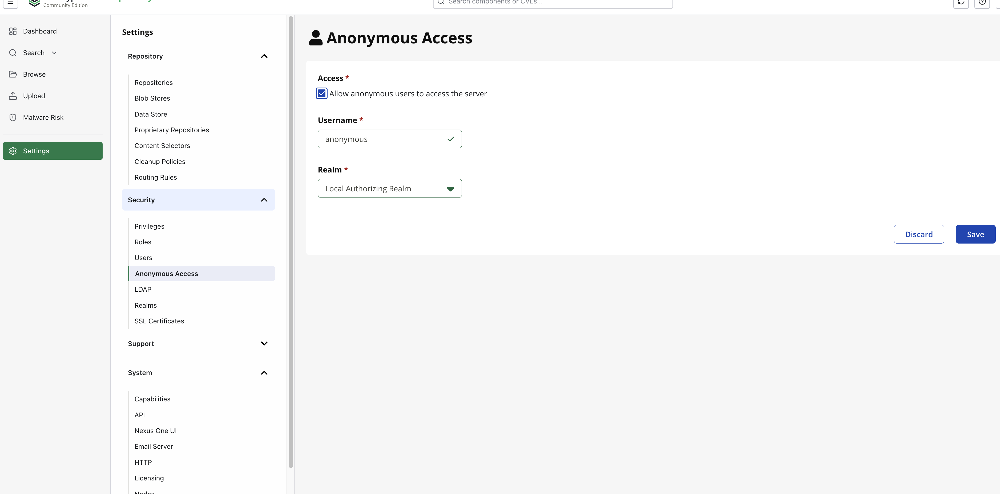
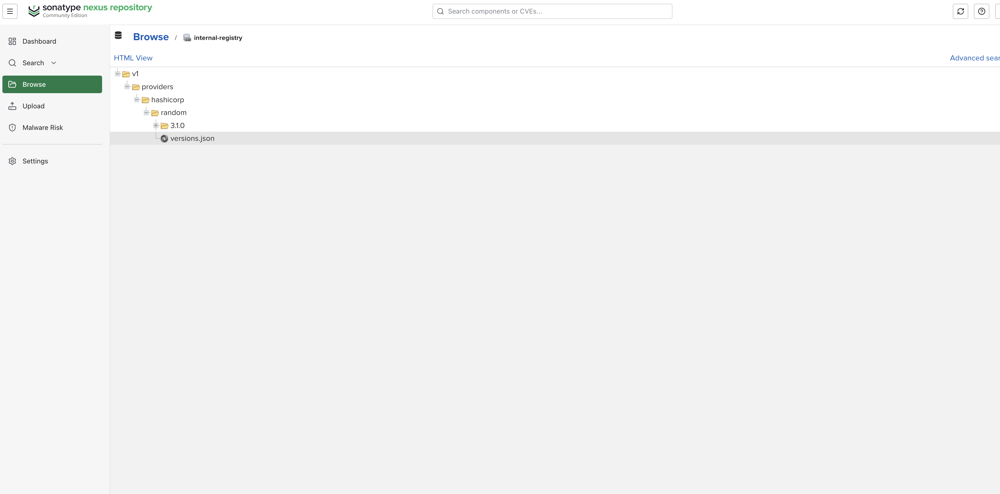

+++
authors = ["Joshua Jebaraj"]
title = "How to Set Up an Internal Provider Registry for Terraform"
date = "2026-07-02"
description = "In this blog we will see how to setup an internal provider registry for the terraform"
tags = ["Terraform","Security","Devops"]
+++


Hey Folks, hope you are doing well.

Last month I attended an interview for a Devops role at one of the reputed banks in the India. One of the questions they asked 
me "We are a bank we can't download the provider randomly from the internet. Can you tell me how to safely download the provider?". 

Before the interview I thought only the modules cloud be self hosted not the providers. But later I learned that you can self-host providers for terraform too. In this blog we will see how to setup an internal provider registry for the terraform.


## Setting up the internal registry 

For the internal registry I am using Nexus(Community Edition) which is free and easy to setup, and I am going to run it via Docker:
```bash
docker run -d -p 8081:8081 --name nexus sonatype/nexus3
```

> Wait for sometime to get the container up and running

Next, get the initial admin password by running the below command

```
docker exec nexus cat /nexus-data/admin.password
```
Now go to the Login into the nexus UI on http://localhost:8081 with the username `admin` and password you got from the above command


Go to the `Settings` page and Select `Repositories` and click the `Create Repository` button.



On the next page, select `terraform proxy` as the option. In the Name field enter `internal-registry` and in the remote storage enter the `https://registry.terraform.io` this URL. 


Next go to the Settings->Security->Realms, move Terraform Token Realm to the Active Column, and click Save.



Now we have to enable anonymous access to the internal registry, so that we can donwload providers without authentication. Go to Settings-> Security->Anonymous Access and enable it.



> Note : Since this is a demo, I am enabling anonymous access. In the real world you shouldn't use anonymous access; instead, use a username and an API token to download providers.


### Setting up the terraform 

Now that we have setup the internal registry, lets configure Terraform to use it. 

First , create a CLI Configuration file that points Terraform at the internal registry:
```
host "registry.terraform.io" {
  services = {
    "providers.v1" = "http://localhost:8081/repository/internal-registry/v1/providers/"
  }
}
```
Save this file as `terraform.rc` in the current directory.

Next create the main.tf file and fill it with the below content

```
terraform {
  required_version = ">= 1.5.0 "

  required_providers {
    random = {
      source  = "hashicorp/random"
      version = "3.1.0"
    }
  }
}
```

Now point Terraform at the CLI configuration file by exporting the TF_CLI_CONFIG_FILE environment variable:

```
export TF_CLI_CONFIG_FILE="$(pwd)/terraform.rc"
```

Now run:

```
terraform init 
```

Now go to the nexus UI and and open the `internal-registry` you will be seeing the random provider cached there.




That's how you can set up an internal provider registry for Terraform. I hope you folks learned something and enjoyed the blog. If you have any questions or feedback, feel free to reach out.